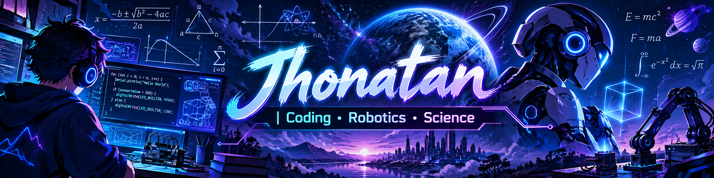

# Hi there! I'm Jhonatan 👋
# Hi there! I'm Jhonatan 👋

### Welcome to my GitHub!

I'm a student passionate about **mathematics, robotics, science, programming, video games, and anime**.

I love learning new things, solving problems, and discovering how technology works.

---

### My Interests

- 🤖 **Robotics & Arduino** — Building robots and exploring electronics.
- 🧮 **Mathematics** — Logic, challenges, and problem-solving.
- 💻 **Programming** — Learning to create software and algorithms.
- 🎮 **Game Development** — Exploring how video games are made.
- 🔬 **Science** — Experiments, discoveries, and technology.
- 🎌 **Anime** — Enjoying Japanese animation and creative stories.

### My Learning Journey

I'm exploring programming, robotics, and electronics through practical projects.

My goal is to keep improving my skills, create interesting things, and share what I learn.

### Projects I'm Interested In

- Arduino robots and smart devices
- Autonomous robotic cars
- Mathematical simulations
- Small games and interactive applications
- Science and electronics experiments

---

**Keep learning. Keep creating. Never stop exploring!**
